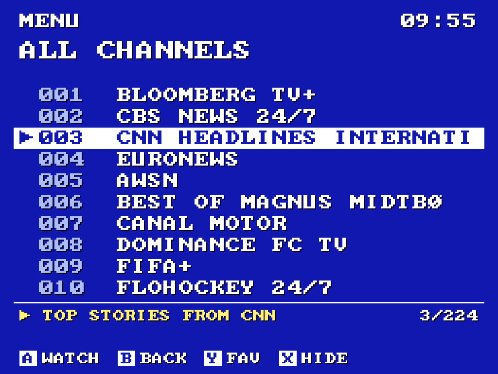
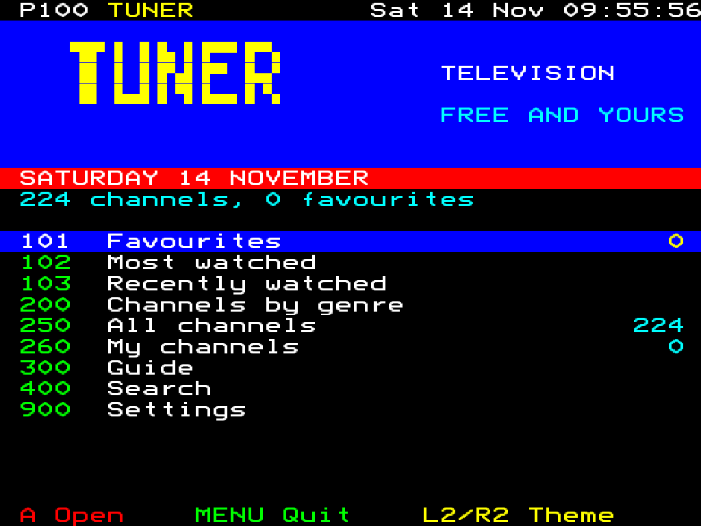
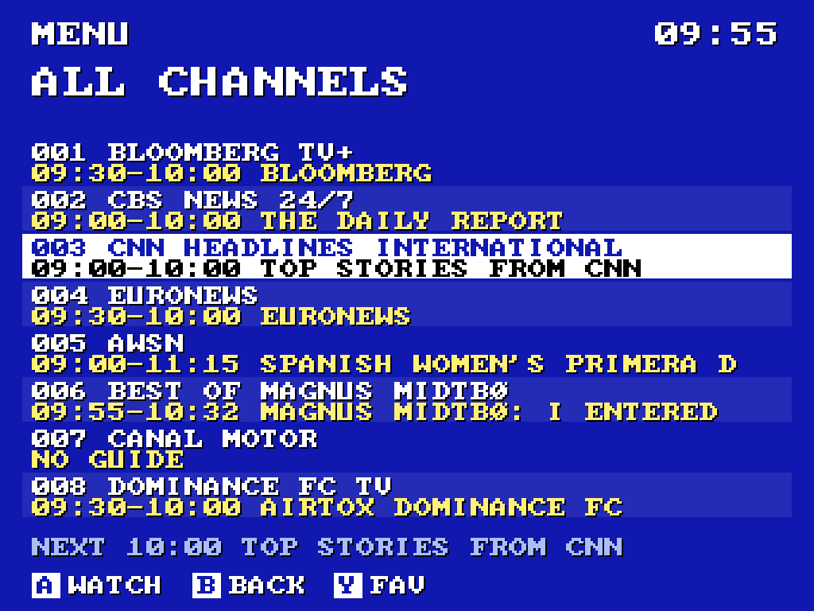
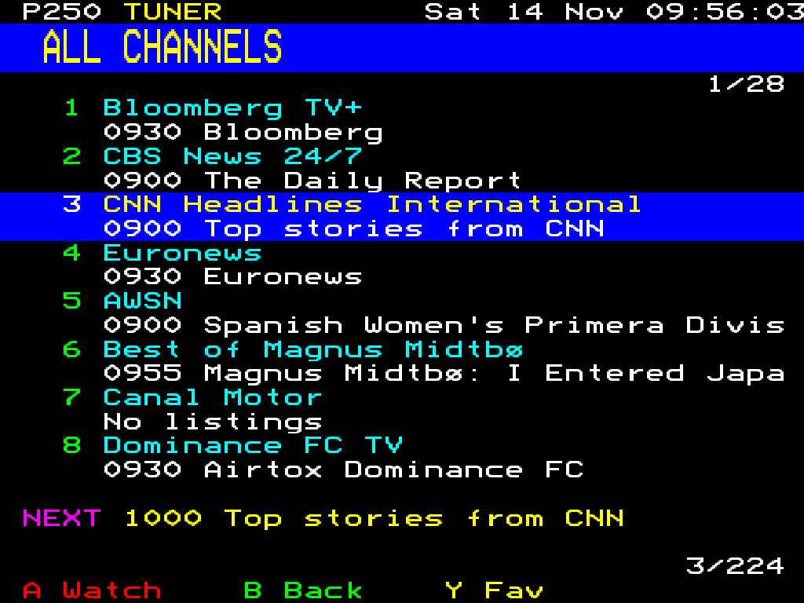
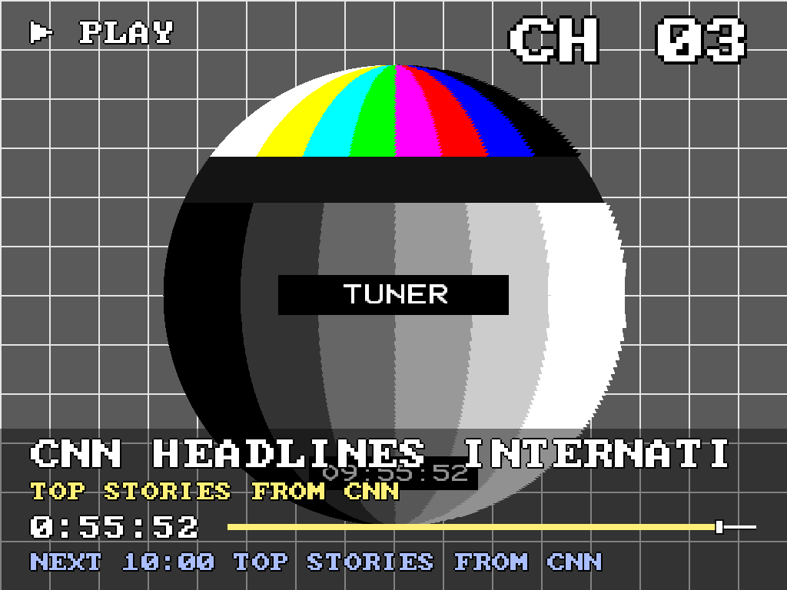
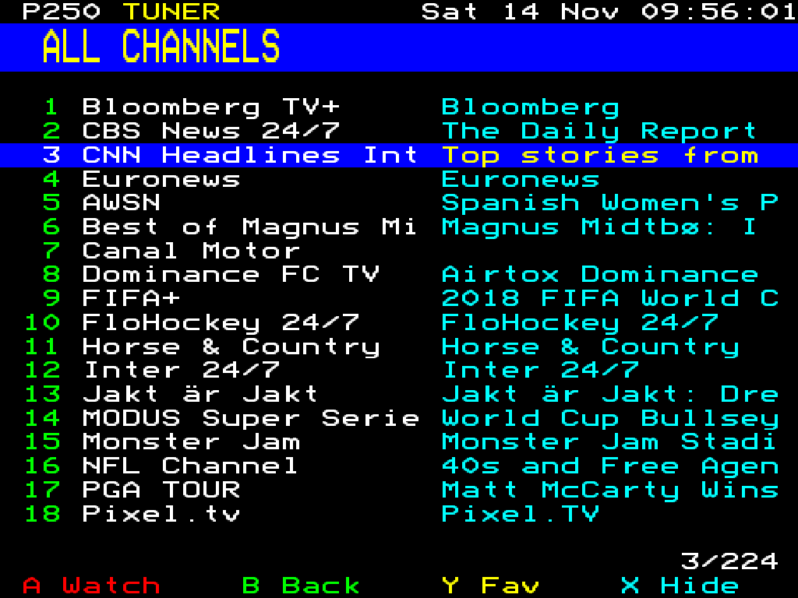
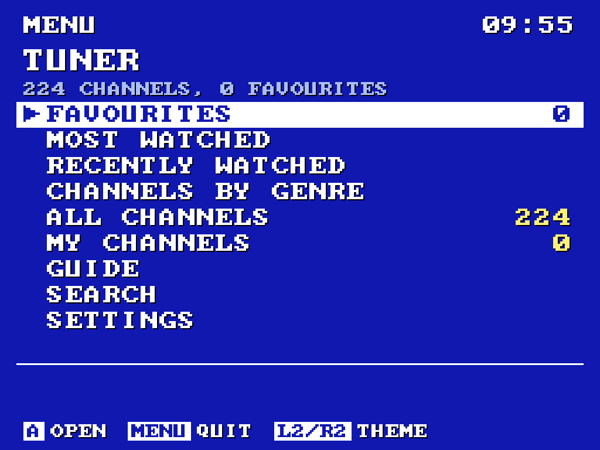
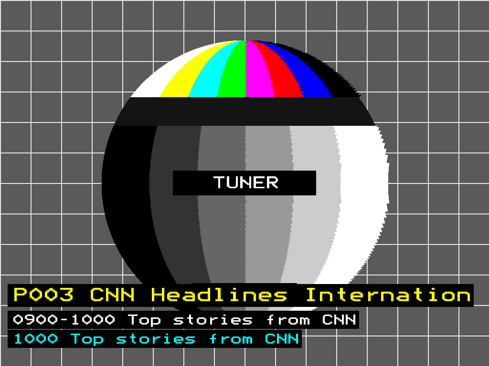
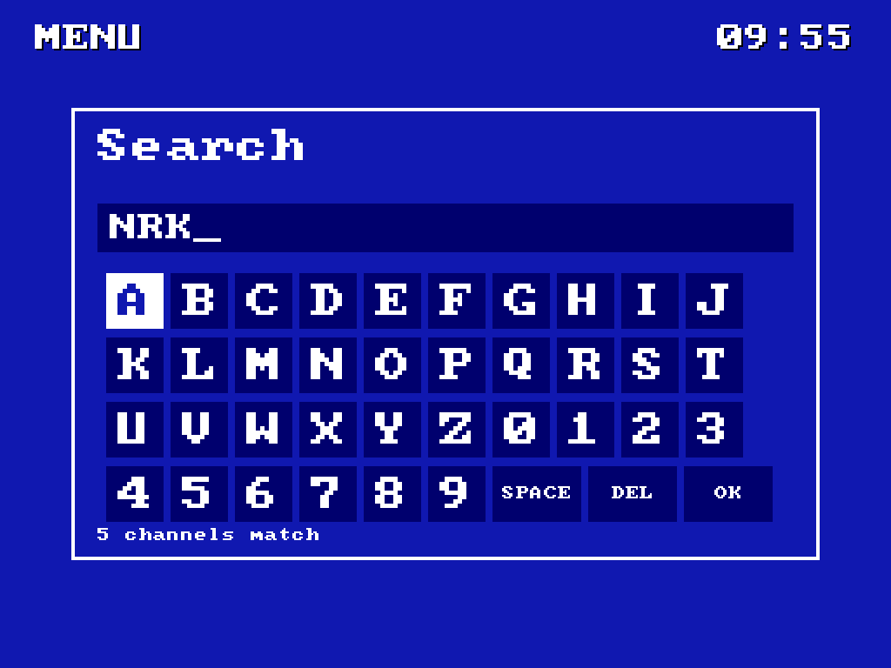

# Tuner – IPTV Player for NextUI

Free TV on the TrimUI Brick with an old-school look. Tuner finds free channels for the languages and countries you
pick, shows what's on, and plays them with the snow, test cards and channel numbers of an old TV set.

- **Channels:** Pluto TV and Samsung TV Plus (with their TV guides), the public channel lists from
  [iptv-org](https://github.com/iptv-org/iptv), and your own M3U playlists and Xtream Codes accounts.
- **TV guide:** now and next on every channel that has one, and a listings guide. Guides come from the services
  themselves, [i.mjh.nz](https://i.mjh.nz) and [epgshare01](https://epgshare01.online) (national channels), or your
  own XMLTV and your Xtream provider's guide (kept for a day, read quickly even when it's tens of MB).
- **Two looks**, switched with L2/R2:
  - **VCR**: a video recorder's on-screen display in big blocky letters, over the live picture (or the blue screen
    when nothing plays). Holding up or down winds the tape (FF/REW with tracking noise), a new channel comes in with
    tracking noise, the banner has a tape counter, and loading is TRACKING with 12:00 blinking.
  - **Teletext**: pages on the 40x25 grid. A page you open is searched for first (the header's page counter rolls by)
    and then arrives row by row. A block-graphics masthead on P100, a real listings page on P300, coloured fastext
    labels, and the channel info as newsflash boxes over the picture.
- **Hardware video decoding:** H.264 and H.265 are decoded on the Brick's video engine, which takes about a fifth of
  one CPU core where software decoding takes three (Settings > Hardware decoding; anything else stays in software).
- **Audio tracks:** on channels with several (often marked MULTI), Tuner picks the one in your languages; LEFT/RIGHT
  switches while watching, and your choice is remembered per channel.
- **Stats for nerds** (SELECT while watching): codec, size and frame rates, dropped frames, A/V sync, queues, the
  stream's bitrate and quality steps, audio tracks, CPU, temperature and Wi-Fi.
- **Tuning in:** snow over the programme's picture while a channel connects and a test card on long waits (or, if
  you prefer, a plain screen with the channel info and LOADING), and a plain-words message when a channel can't be
  played.
- Favourites, Most watched and Recently watched (they fill up by themselves as you watch), search, channel logos,
  scanline and CRT picture overlays, a sleep timer, an adult PIN, and the volume shown when you change it. Tuner starts
  on the channel you watched last, and START (or B on the front page) takes you back to it from the menus.

Tested on the TrimUI Brick (`tg5040`).

## Screenshots

| VCR | Teletext |
|---|---|
|  |  |
|  |  |
|  |  |
|  |  |
| **Search** | |
|  | |

Drawn by Tuner's screenshot mode with nothing tuned, so the test card stands in for the picture; in the VCR look the
live channel plays behind the menus instead.

## Install

**Pak Store:** look for Tuner under Tools.

**By hand:** download `Tuner.pak.zip` from [Releases](../../releases) and unzip it into a new folder on the SD card,
`Tools/tg5040/Tuner.pak/`.

The first start asks whether you want the free channels or only your own playlists, then (for the free channels)
languages, countries and genres, and fetches the channel lists. They're refreshed in the
background once a day (guides every few hours) and kept on the card, so Tuner also starts without Wi-Fi.

## Controls

| Button | In the menus | Watching |
|---|---|---|
| D-pad | Move (left/right: page) | Up/down: change channel. Left/right: audio track |
| A | Open / watch | Show or hide the channel info |
| B | Back (on the front page: back to the channel) | Back to the menu |
| Y | Favourite | Favourite |
| X | Hide channel | Previous channel |
| L1/R1 | Page up/down | Picture overlay (scanlines, CRT) |
| L2/R2 | Look | Look |
| START | Back to the channel you were watching | |
| SELECT | | Stats for nerds |
| MENU | Quit | Quit |

In the VCR look, resting on a channel in a list tunes it in behind the menu.

## Most watched and Recently watched

Tuner keeps track of what you watch, so the channels you like end up on the front page without starring them:

- **Most watched** lists your top 20 channels by watching time. Only real watching counts: the picture has to be
  playing and you have to stay at least 30 seconds, so zapping past doesn't count. Time fades (it halves every two
  weeks), so channels you stop watching slide down by themselves.
- **Recently watched** lists the last 10 channels you watched, newest first.
- **Settings > Suggest favourites** (off by default): after about two hours on a channel that isn't a favourite,
  Tuner suggests starring it, once per channel.

This is kept on the SD card next to your favourites (`watched.txt`, `recent.txt`) and never leaves the device.

## Your own channels

Copy `playlists.example.txt` to `playlists.txt` in the pak folder and add one playlist per line: an M3U URL, an M3U
file in the pak folder, `epg <url or file>` for an XMLTV guide, or `xtream <server> <username> <password>` for an
Xtream Codes account (channels, categories and guide come through the provider's API; add `m3u8` at the end for HLS). Your channels appear under **My channels** and
are never hidden by the genre or quality settings. They're browsed by the playlist's own groups, in playlist order
(or A-Z, in Settings). Settings > Free channels OFF uses only your playlists. Settings > Refresh channels now reloads
them.

**Privacy:** Tuner never writes your playlist addresses, Xtream server logins or stream URLs to its log
(`Logs/Tuner.txt`). It logs channel names only, and every address in the video library's own error messages is
replaced by `[url]`. Your playlists.txt stays on your SD card.

Settings, favourites and the cache live in `.userdata/tg5040/Tuner/` on the SD card.

## Building

```sh
build/build-ffmpeg.sh   # a minimal static ffmpeg 6.1.2 (HLS, MPEG-TS, H.264/H.265, AAC/MP3/AC-3, HTTPS)
build/build-app.sh      # Tuner itself -> build/out/tuner
./package.sh            # dist/Tuner.pak.zip
```

Both scripts build in an ARM64 Debian bullseye Docker container (glibc 2.31, OpenSSL 1.1, like the Brick); Apple
Silicon builds natively. They need `deps/ffmpeg-6.1.2.tar.xz` from [ffmpeg.org](https://ffmpeg.org/releases/).
Tuner links the Brick's own SDL2, SDL2_image, SDL2_ttf, OpenSSL and zlib. The Brick's ffmpeg has no HLS or HTTPS,
hence the static one.

Hardware decoding (`src/hwdec.c`) loads Allwinner's CedarC libraries from the Brick's `/usr/lib` at run time; they
aren't part of this repository or the pak. Its struct layouts follow CedarC 1.3.0 as built for the Brick and were
checked against the library's own code.

Pushing a tag `vX.Y.Z` that matches `version` in `pak.json` makes a GitHub release with the zip attached.

## Made with an AI assistant

This project was built with the help of an LLM (Claude, by Anthropic): the code, build scripts and documentation were
written in conversation with it, and tested on a real TrimUI Brick.

## Licenses and credits

- Tuner's own code is MIT ([LICENSE](LICENSE)).
- [FFmpeg](https://ffmpeg.org) 6.1.2 is LGPL 2.1 ([LICENSE-ffmpeg-LGPL](LICENSE-ffmpeg-LGPL)), linked statically.
  Its unmodified source is at ffmpeg.org, the exact configuration is `build/build-ffmpeg.sh`, and this repository has
  everything needed to rebuild and relink Tuner.
- [cJSON](https://github.com/DaveGamble/cJSON) is MIT (`src/vendor/LICENSE-cJSON`).
- The [Bedstead](https://bjh21.me.uk/bedstead/) font is public domain.
- The VCR look's 8x8 pixel font is [font8x8](https://github.com/dhepper/font8x8) by Daniel Hepper, public domain
  (after the public domain IBM VGA fonts).
- Channel lists: [iptv-org](https://github.com/iptv-org/iptv) and [i.mjh.nz](https://i.mjh.nz); guides also from
  [epgshare01](https://epgshare01.online).

Tuner only plays streams the services make freely available (and those in your own playlists). It isn't affiliated with Pluto TV, Samsung TV Plus or
any broadcaster, and their names belong to their owners.
