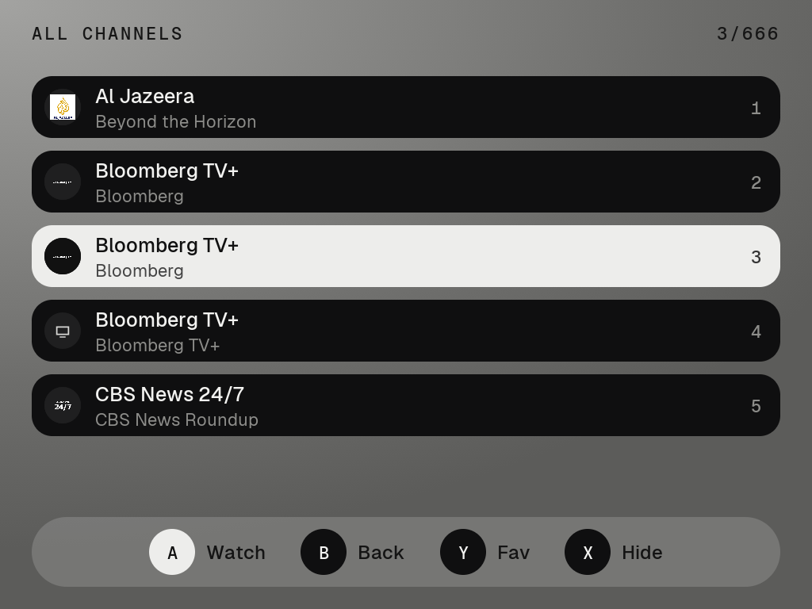
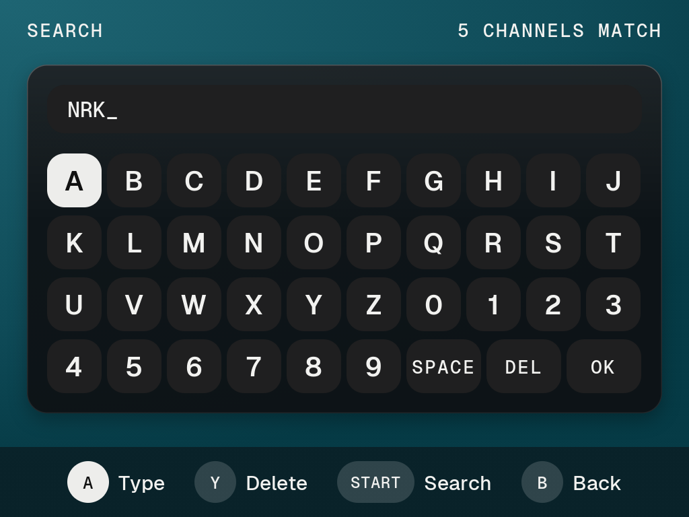

# Tuner – free TV for NextUI

Free TV channels on the TrimUI Brick (`tg5040`). Pick your languages and countries, and Tuner finds the channels,
shows what's on now and next, and plays them: Pluto TV, Samsung TV Plus, iptv-org's public lists, or your own M3U
playlists and Xtream accounts. Drawn with [Dot](https://github.com/evolver79/nextui-dotui), the shared look of Kino,
Musicdisk and Tuner.

- **Channels:** Pluto TV and Samsung TV Plus, the public lists from [iptv-org](https://github.com/iptv-org/iptv), and
  your own M3U playlists and Xtream Codes accounts.
- **TV guide:** now and next on every channel that has one, and a Guide page with what's on across your channels.
  Guides come from the services themselves, [i.mjh.nz](https://i.mjh.nz), [epgshare01](https://epgshare01.online),
  your own XMLTV or your Xtream provider.
- **Favourites and history:** Favourites, Most watched and Recently watched fill the front page as you watch. Search
  covers every channel.
- **Watching:** the channel you rest on in a list tunes in behind the menu. A banner shows what's on, how far in, and
  what's next. Snow over the programme's picture while a channel connects, the time in dots on long waits, and a
  plain-words message when a channel can't be played.
- **Audio tracks:** on channels with several (often marked MULTI), Tuner picks the one in your languages. LEFT/RIGHT
  switches, and your choice is remembered per channel.
- **Hardware decoding:** H.264 and H.265 run on the Brick's video engine, about a fifth of one CPU core where
  software decoding takes three.
- **Stats for nerds** (SELECT while watching): codec, size and frame rates, dropped frames, A/V sync, bitrate and
  quality steps, CPU, temperature and Wi-Fi.
- **Also:** channel logos, scanline and CRT picture overlays, a sleep timer, an adult PIN, and the volume shown when
  you change it. Tuner starts on the channel you watched last.

## Screenshots

| | |
|---|---|
|  |  |
|  |  |
|  |  |
|  |  |

Taken with Tuner's screenshot mode, so no channel is playing: the channel info sits on the waiting screen and the
menus on Tuner's teal ground. On the Brick the live channel plays behind both.

## Install

**Pak Store:** look for Tuner under Tools.

**By hand:** download `Tuner.pak.zip` from [Releases](../../releases) and unzip it into a new folder on the SD card,
`Tools/tg5040/Tuner.pak/`.

The first start needs Wi-Fi. It asks whether you want the free channels or only your own playlists, then (for the
free channels) languages, countries and genres, and fetches the channel lists. Religious, shopping, legislative and
adult channels are left out unless you pick them. The lists are kept on the card, so Tuner also starts without
Wi-Fi.

Each start reloads channel lists older than a day and guides older than 6 to 12 hours. A big Xtream provider guide
downloads in the background and is used from the next start.

**Updating:** update from the Pak Store, or unzip a new release over the old folder. Settings, favourites and history
are kept in `.userdata/tg5040/Tuner/` and survive the update.

## Controls

| Button | In the menus | Watching |
|---|---|---|
| D-pad | Move (left/right: page) | Up/down: change channel. Left/right: audio track |
| A | Open / watch | Show or hide the channel info |
| B | Back (on the front page: back to the channel) | Back to the menu |
| Y | Favourite | Favourite |
| X | Hide channel (in lists) | Previous channel |
| L1/R1 | Page up/down | Picture overlay (scanlines, CRT) |
| L2/R2 | | Crop black borders on/off |
| START | Back to the channel you were watching | |
| SELECT | | Stats for nerds |
| MENU | Quit | Quit |

The front page scrolls: the Guide, My channels, Search and Settings are further down. In Search, A types a letter,
Y or X deletes one, and START searches. In the first-time setup, START goes to the next step.

## Settings

- **Languages, Countries, Genres:** what the free channels are picked by.
- **Max quality:** 480p, 720p (the default) or 1080p. It also picks the stream's quality step.
- **Picture:** off, light or strong scanlines, or CRT (also L1/R1 while watching).
- **Crop black borders:** OFF (the default) or AUTO (also L2/R2 while watching). AUTO finds black bars and cuts
  them away, so a 4:3 film shown inside a 16:9 channel fills the screen. It waits a few seconds before zooming in,
  so a dark scene doesn't set it off, and zooms back out at once when the picture fills the frame again.
- **Tuning screen:** Snow + picture (the default), or Plain: only the channel info while it connects.
- **Sleep timer:** 30, 60, 90 or 120 minutes, with a warning a minute before.
- **Adult channels** and **Adult PIN**.
- **Show hidden channels again:** the ones you hid, and the ones Tuner hid because they had no signal.
- **Free channels:** OFF uses only your own playlists. **Refresh channels now** reloads everything.
- **Suggest favourites**, **Hardware decoding**, **My channels order**, and **Run first-time setup again**.

When the stream runs dry, Tuner says Buffering over the frozen picture. When a channel stops, Tuner tries to
reconnect it three times (Reconnecting 1/3 on screen). If it still has no signal, it says so and hides the
channel for a week.

## Most watched and Recently watched

- **Most watched** shows your top 20 channels by watching time. Only real watching counts (at least 30 seconds with
  the picture playing), and older watching fades, so channels you stop watching slide down by themselves.
- **Recently watched** shows the last 10 channels, newest first.
- **Settings > Suggest favourites** (off by default): after about two hours on a channel that isn't a favourite,
  Tuner suggests starring it, once per channel.

## Your own channels

Copy `playlists.example.txt` to `playlists.txt` in the pak folder and add one entry per line:

```
https://example.com/list.m3u
my-list.m3u
epg https://example.com/guide.xml
xtream http://provider.example:8080 username password
```

That is an M3U URL, an M3U file in the pak folder, an XMLTV guide (URL or file), and an Xtream Codes account, whose
channels, categories and guide come through the provider's API. If an Xtream provider's channels don't play, add
`m3u8` at the end of its line to ask for HLS streams.

Your channels appear under **My channels**, browsed by the playlist's own groups in playlist order (or A-Z, in
Settings), and are never hidden by the genre or quality settings. Settings > Refresh channels now reloads them.

## Privacy

What you watch, your favourites and your playlists stay on the SD card and never leave the device. Tuner never writes
your playlist addresses, Xtream logins or stream URLs to its log (`Logs/Tuner.txt`): it logs channel names only, and
every address in the video library's own error messages is replaced by `[url]`.

## Troubleshooting

- **A channel won't play:** free streams come and go. Try another channel, or Settings > Refresh channels now.
- **The picture stutters:** check that Settings > Hardware decoding is ON, or lower Max quality.
- **Logs:** `Logs/Tuner.txt` on the SD card. It has no addresses or passwords, so it's safe to attach to an
  [issue](../../issues).

## Building

```sh
git clone --recursive https://github.com/evolver79/nextui-tuner-pak   # or: git submodule update --init (ui/dot)
# download ffmpeg-6.1.2.tar.xz from https://ffmpeg.org/releases/ into deps/
build/build-ffmpeg.sh   # a minimal static ffmpeg 6.1.2 (HLS, MPEG-TS, H.264/H.265, AAC/MP3/AC-3, HTTPS)
build/build-app.sh      # Tuner itself -> build/out/tuner
./package.sh            # dist/Tuner.pak.zip
```

The build scripts need Docker: they build in an ARM64 Debian bullseye container (glibc 2.31, OpenSSL 1.1, like the
Brick), natively on Apple Silicon. Tuner links the Brick's own SDL2, SDL2_image, SDL2_ttf, OpenSSL and zlib. The
Brick's ffmpeg has no HLS or HTTPS, hence the static one.

Hardware decoding (`src/hwdec.c`) loads Allwinner's CedarC libraries from the Brick's `/usr/lib` at run time; they
aren't part of this repository or the pak. Its struct layouts follow CedarC 1.3.0 as built for the Brick and were
checked against the library's own code.

Pushing a tag `vX.Y.Z` that matches `version` in `pak.json` makes a GitHub release with the zip attached.

## Made with an AI assistant

Built with the help of Claude (Anthropic): the code, build scripts and documentation were written in conversation
with it, and tested on a real TrimUI Brick.

## Licences and credits

- Tuner's own code is MIT ([LICENSE](LICENSE)).
- [FFmpeg](https://ffmpeg.org) 6.1.2 is LGPL 2.1 ([LICENSE-ffmpeg-LGPL](LICENSE-ffmpeg-LGPL)), linked statically.
  Its unmodified source is at ffmpeg.org, the exact configuration is `build/build-ffmpeg.sh`, and this repository has
  everything needed to rebuild and relink Tuner.
- [cJSON](https://github.com/DaveGamble/cJSON) is MIT (`src/vendor/LICENSE-cJSON`).
- The fonts (Doto, Geist) come with [Dot](https://github.com/evolver79/nextui-dotui) and are SIL OFL.
- Channel lists: [iptv-org](https://github.com/iptv-org/iptv) and [i.mjh.nz](https://i.mjh.nz); guides also from
  [epgshare01](https://epgshare01.online).

Tuner plays only streams that their services make freely available, plus your own playlists. It hosts no streams and
isn't affiliated with Pluto TV, Samsung TV Plus or any broadcaster; their names belong to their owners.
