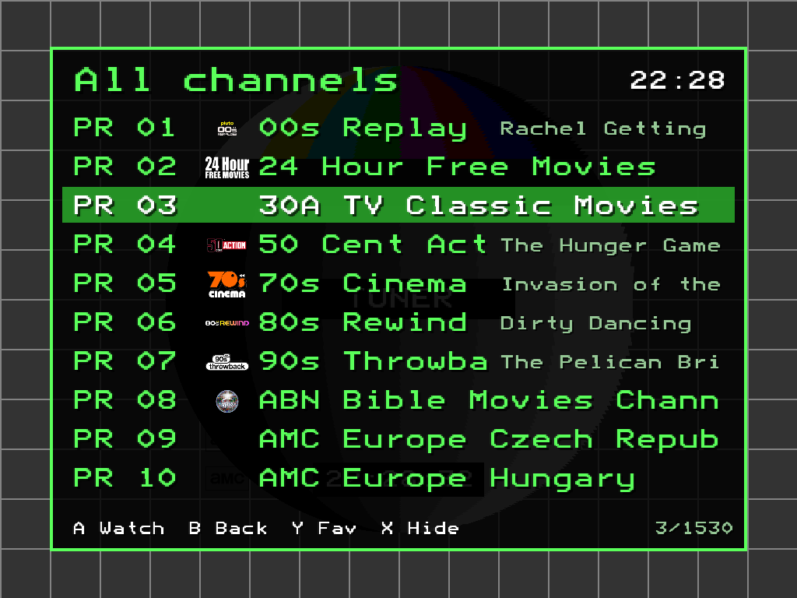
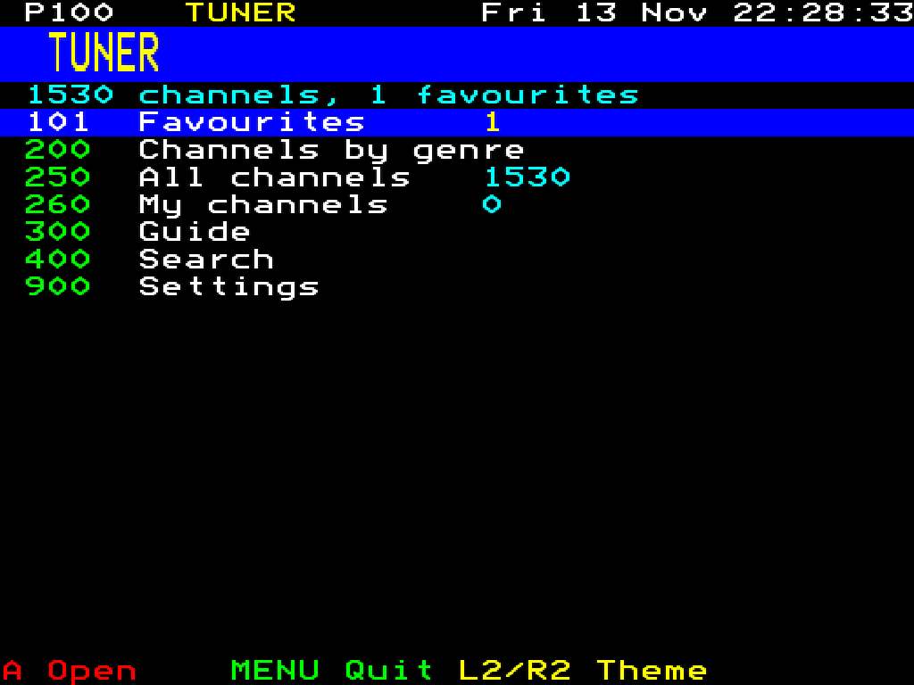
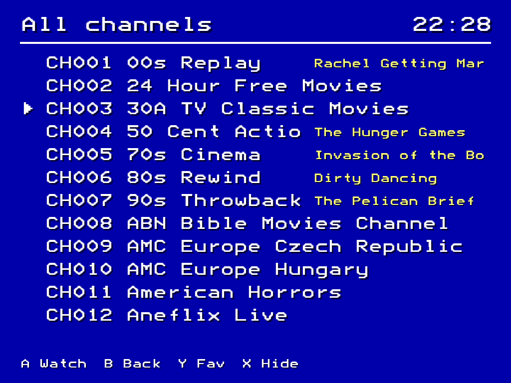
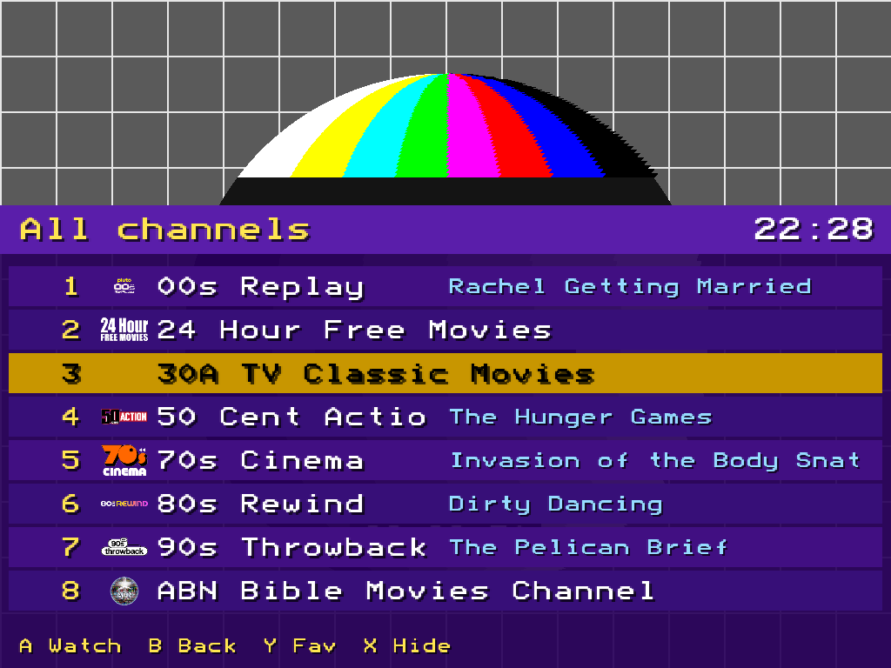
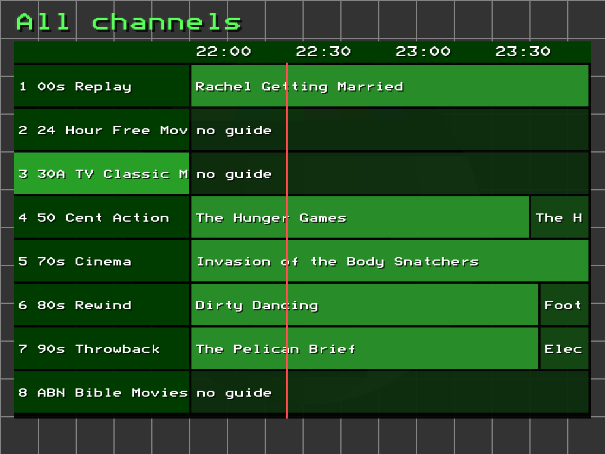
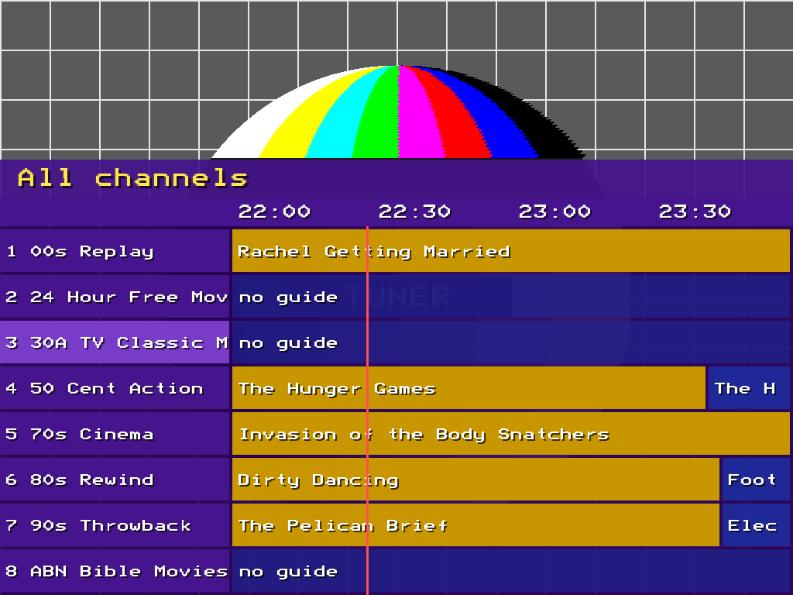
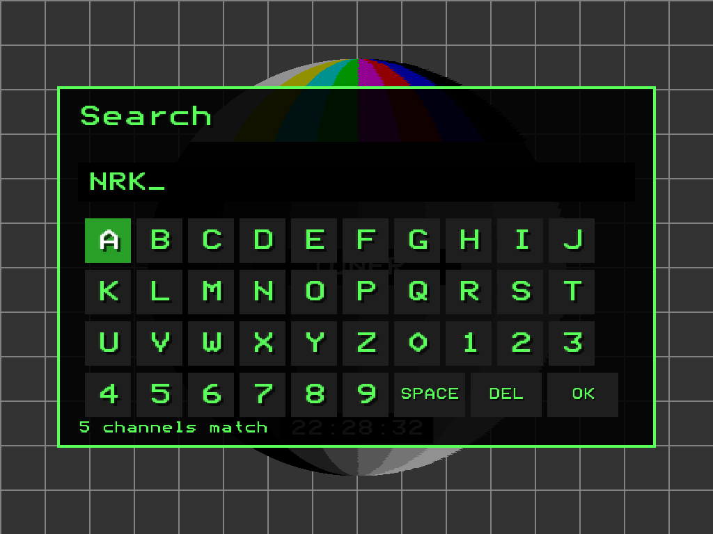

# Tuner – IPTV Player for NextUI

Free TV on the TrimUI Brick with an old-school look. Tuner finds free channels for the languages and countries you
pick, shows what's on, and plays them with the snow, test cards and channel numbers of an old TV set.

- **Channels:** Pluto TV and Samsung TV Plus (with their TV guides), the public channel lists from
  [iptv-org](https://github.com/iptv-org/iptv), and your own M3U playlists.
- **TV guide:** now/next on every channel that has one, and a guide grid. Guides come from the services themselves,
  [i.mjh.nz](https://i.mjh.nz) and [epgshare01](https://epgshare01.online) (national channels), or your own XMLTV.
- **Four looks**, switched with L2/R2:
  - **CRT TV**: a 90s TV's on-screen menus over the live picture.
  - **Teletext**: pages, page numbers and coloured fastext labels.
  - **VCR**: the video recorder's blue screen.
  - **Cable guide**: listings on a purple panel under the live picture.
- **Tuning in:** snow over the programme's picture while a channel connects and a test card on long waits (or, if
  you prefer, a plain screen with the channel info and LOADING), and a plain-words message when a channel can't be
  played.
- Favourites, search, channel logos, scanline and CRT picture overlays, a sleep timer, an adult PIN. Tuner starts on
  the channel you watched last.

Tested on the TrimUI Brick (`tg5040`).

## Screenshots

| CRT TV | Teletext |
|---|---|
|  |  |
| **VCR** | **Cable guide** |
|  |  |
| **TV guide (CRT TV)** | **TV guide (Cable guide)** |
|  |  |
| **Search** | |
|  | |

Taken on the Brick with nothing tuned, so the test card is behind the menus; in the CRT TV and Cable guide looks the
live channel plays there instead.

## Install

**Pak Store:** look for Tuner under Tools.

**By hand:** download `Tuner.pak.zip` from [Releases](../../releases) and unzip it into a new folder on the SD card,
`Tools/tg5040/Tuner.pak/`.

The first start asks whether you want the free channels or only your own playlists, then (for the free channels)
languages, countries and genres, and fetches the channel lists. They're refreshed in the
background once a day (guides every few hours) and kept on the card, so Tuner also starts without Wi-Fi.

## Controls

| Button | In the menus | Watching |
|---|---|---|
| D-pad | Move (left/right: page) | Up/down: change channel |
| A | Open / watch | Show or hide the channel info |
| B | Back | Back to the menu |
| Y | Favourite | Favourite |
| X | Hide channel | Previous channel |
| L1/R1 | Page up/down | Picture overlay (scanlines, CRT) |
| L2/R2 | Theme | Theme |
| Select | | FPS counter |
| MENU | Quit | Quit |

In the CRT TV and Cable guide looks, resting on a channel in a list tunes it in behind the menu.

## Your own channels

Copy `playlists.example.txt` to `playlists.txt` in the pak folder and add one playlist per line: an M3U URL, an M3U
file in the pak folder, or `epg <url or file>` for an XMLTV guide. Your channels appear under **My channels** and
are never hidden by the genre or quality settings. They're browsed by the playlist's own groups, in playlist order
(or A-Z, in Settings). Settings > Free channels OFF uses only your playlists. Settings > Refresh channels now reloads
them.

Settings, favourites and the cache live in `.userdata/tg5040/Tuner/` on the SD card.

## Building

```sh
build/build-ffmpeg.sh   # a minimal static ffmpeg 6.1.2 (HLS, MPEG-TS, H.264/H.265, AAC/MP3/AC-3, HTTPS)
build/build-app.sh      # Tuner itself -> build/out/tuner
./package.sh            # dist/Tuner.pak.zip
```

Both scripts build in an ARM64 Debian bullseye Docker container (glibc 2.31, OpenSSL 1.1, like the Brick); Apple
Silicon builds natively. They need `deps/ffmpeg-6.1.2.tar.xz` from [ffmpeg.org](https://ffmpeg.org/releases/).
Tuner links the Brick's own SDL2, SDL2_image, SDL2_ttf, OpenSSL and zlib. The Brick's ffmpeg has no HLS or HTTPS,
hence the static one.

Pushing a tag `vX.Y.Z` that matches `version` in `pak.json` makes a GitHub release with the zip attached.

## Made with an AI assistant

This project was built with the help of an LLM (Claude, by Anthropic): the code, build scripts and documentation were
written in conversation with it, and tested on a real TrimUI Brick.

## Licenses and credits

- Tuner's own code is MIT ([LICENSE](LICENSE)).
- [FFmpeg](https://ffmpeg.org) 6.1.2 is LGPL 2.1 ([LICENSE-ffmpeg-LGPL](LICENSE-ffmpeg-LGPL)), linked statically.
  Its unmodified source is at ffmpeg.org, the exact configuration is `build/build-ffmpeg.sh`, and this repository has
  everything needed to rebuild and relink Tuner.
- [cJSON](https://github.com/DaveGamble/cJSON) is MIT (`src/vendor/LICENSE-cJSON`).
- The [Bedstead](https://bjh21.me.uk/bedstead/) font is public domain.
- Channel lists: [iptv-org](https://github.com/iptv-org/iptv) and [i.mjh.nz](https://i.mjh.nz); guides also from
  [epgshare01](https://epgshare01.online).

Tuner only plays streams the services make freely available. It isn't affiliated with Pluto TV, Samsung TV Plus or
any broadcaster, and their names belong to their owners.
